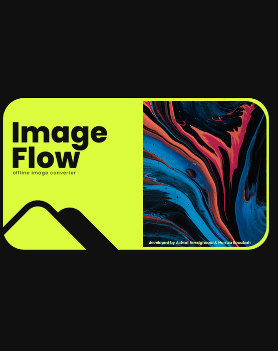

# ImageFlow
[](https://github.com/achrafness/ImageFlow/releases/latest)
### cross-platform, image format conversion GUI tool, built with Python.
<p>Often times we need to convert different images from one format to another, especially from .HEIC to .JPG or .PNG, due to .HEIC's incompatibilty with design software like photoshop.<br>
There are already many free online solutions, but when we have a decent amount of images to convert, they tend take some time to upload, that is where our tool comes into play, no need to upload your images anymore, just convert them right away on your computer, completely offline.<br>

## Demo
<p align="center">
  
</p>

## Technologies used
- PyQt6.
- Pillow + pillow-heif (image conversion, no system libraries needed).

## Installation
If just want to use the application, you can download the executable for Windows, macOS or Linux from the [latest release](https://github.com/achrafness/ImageFlow/releases/latest), and if you want to run it manually with python, do the following:
- clone the repository.
- run the command (preferably in a virtual environment)
```bash 
pip install -r requirements.txt
```
- after installing the dependencies, run the app using
```bash 
python ImageFlow.py
```

Python 3.9 or newer is required. Everything else is installed by pip, on Windows, macOS and Linux.<br>
On some Linux distributions Qt also needs the `libxcb-cursor0` system package (`sudo apt install libxcb-cursor0`).

## Building a standalone executable
An executable has to be built on the OS it is meant for:
```bash
pip install -r requirements.txt pyinstaller
pyinstaller ImageFlow.spec
```
The result is in the `dist` folder and runs without Python installed.<br>
The `Build executables` GitHub Actions workflow builds it for Windows, macOS and Linux.

## Releases
The current version is in `version.py`. To publish a new release, update it, then tag and push:
```bash
git tag v1.0.0
git push origin v1.0.0
```
The workflow builds the three executables and attaches them to a new GitHub release.

## Requirements

### Functional Requirements

1. **Image Format Conversion:**
   - The tool should support conversion between multiple image formats, including .HEIC, .JPG, .PNG, and potentially other formats commonly used in design and photography.
   - The conversion process should be efficient and handle multiple images at once, allowing batch processing.

2. **Offline Usage:**
   - The application must work fully offline to ensure user data privacy and eliminate dependency on internet connectivity.
   - Users can convert images directly on their local machine without any upload requirement.

3. **User Interface (UI):**
   - Provide a simple and intuitive UI for selecting files, setting the output format, and choosing the destination folder.
   - The interface should include options to view and preview selected images, add or remove files from the conversion list, and display conversion progress.
   - Error messages and alerts should be user-friendly, guiding the user on any issues (e.g., unsupported formats or errors in the conversion process).

### Non-Functional Requirements

1. **Performance:**
   - Ensure efficient conversion times for large batches of images.

2. **Cross-Platform Compatibility:**
   - The application should run on Windows, macOS, and Linux.

3. **Security:**
   - Ensure no sensitive data is saved or transmitted; conversions happen entirely offline.

4. **Scalability:**
   - The tool should handle large numbers of images (100+ at a time) without crashing or slowing down considerably.
